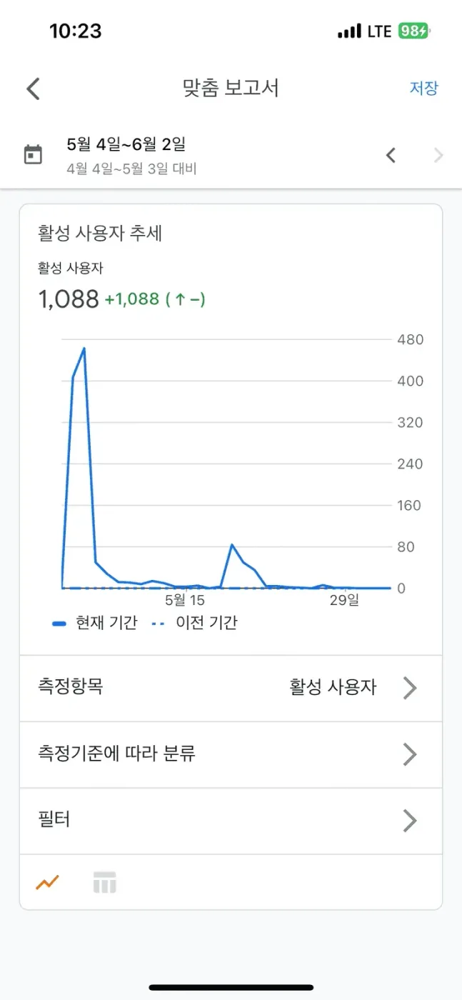
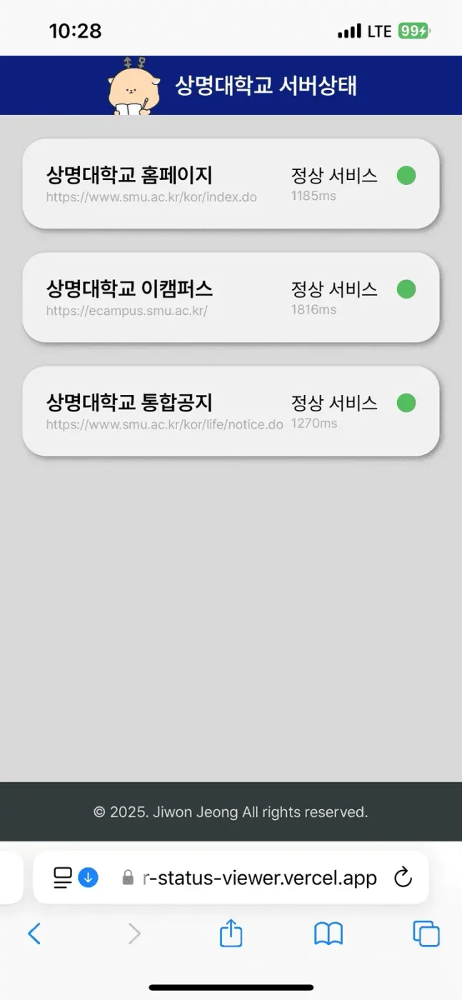
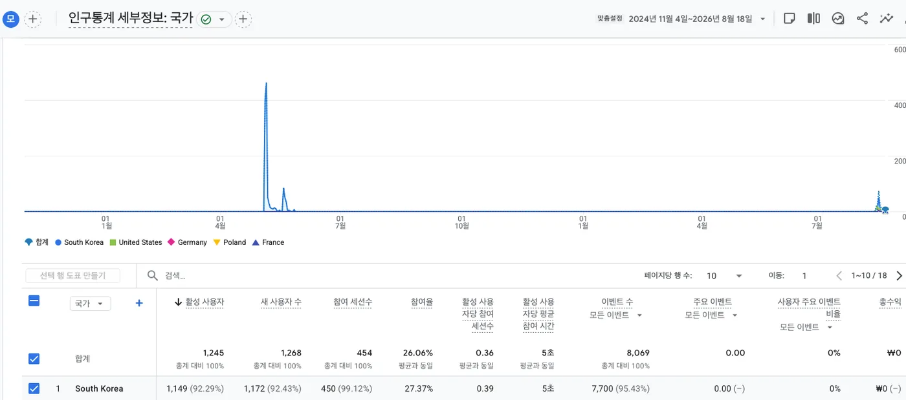

<div align="center">


# 스뮤온 (SMUON)

**상명대학교 주요 웹서비스의 서버 상태를 실시간으로 확인하고, AI로 복구 시점을 가늠하는 서비스**


[**서비스 바로가기 →**](https://www.issmuok.site) · [변경 이력](CHANGELOG.md)




</div>

## 소개

상명대 이캠퍼스 서버 장애 때 학생들이 원인도 모른 채 빈 화면만 보던 상황에서, 주요 서비스의 접속 여부와 응답 속도를 한눈에 보여주려고 만든 모니터링 서비스입니다.

- 에브리타임 HOT 게시물에 오르며 누적 활성 사용자 **1,317명**
- 구글 '상명대 서버' 검색 상위 노출 (서버 상태 모니터링 서비스 중 1위)

<p align="center"></p>

## 주요 기능

| 기능 | 설명 |
|---|---|
| 실시간 상태 확인 | 홈페이지·이캠퍼스·샘물·클라우드·공지사항·수강신청 등의 접속 여부와 응답 속도를 15초마다 갱신하고 SSE로 화면에 반영 |
| 빠른 첫 화면 | Next.js ISR로 마지막 상태를 즉시 보여준 뒤 라이브 데이터로 승격해, 백엔드 콜드스타트가 첫 화면을 막지 않음 |
| 장애 알림 | 30초 이상 지속된 상태 전환만 확정해 Discord 웹훅·이메일로 알림 (순간적인 깜빡임은 무시) |
| AI 장애 분석 | 장애가 확정되면 같은 시간대·요일·학사일정의 과거 장애 빈도와 복구 시간을 근거로 "일시적 vs 지속적"을 판정. 장애당 1회만 호출해 비용 상한을 둠 |
| 장애 이력 | 서비스별 최근 오류와 복구까지 걸린 시간을 상세 화면에서 확인 |

## 구조

```
frontend/   Next.js (App Router) · Tailwind CSS — Vercel 배포
backend/    Go 표준 라이브러리 HTTP 서버 — Render 배포
  cmd/server              서버 진입점
  cmd/backfill-incidents  과거 장애 기록 재분석
  internal/statuschecker  각 서비스 접속 점검
  internal/statuscache    15초 주기 갱신 캐시
  internal/statemonitor   상태 전환 감지·디바운스·알림
  internal/incidents      장애 기록 + AI 분석 파이프라인
  internal/httpapi        REST · SSE 엔드포인트
.github/workflows/monitor.yml  /healthz 2차 안전망 (15분 크론)
```

## 로컬 실행

```bash
# 백엔드
cd backend
cp .env.example .env    # 필요한 값만 채우면 됨 (없으면 해당 기능만 조용히 비활성화)
go run ./cmd/server

# 프론트엔드
cd frontend
pnpm install
pnpm dev
```

`DATABASE_URL`, `OPENAI_API_KEY`, Discord 웹훅 등은 모두 선택 사항입니다. 비어 있으면 조회수·AI 문장·알림처럼 그 값에 의존하는 기능만 빠지고 상태 확인은 그대로 동작합니다.

## 히스토리

처음에는 CRA 프론트엔드([SMU-Server-Status-Viewer-FE](https://github.com/jiwonsudo/SMU-Server-Status-Viewer-FE))와 Express 백엔드([SMU-Server-Status-Viewer-BE](https://github.com/jiwonsudo/SMU-Server-Status-Viewer-BE))로 나뉘어 있었습니다. 검색 노출을 위해 Next.js로, 콜드스타트를 줄이기 위해 Go로 각각 다시 작성한 뒤 `git subtree`로 커밋 이력을 보존하며 이 모노레포로 합쳤습니다. 자세한 내용은 [CHANGELOG.md](CHANGELOG.md)와 [CONTEXT.md](CONTEXT.md)를 참고하세요.

## 라이선스

[MIT](LICENSE)
